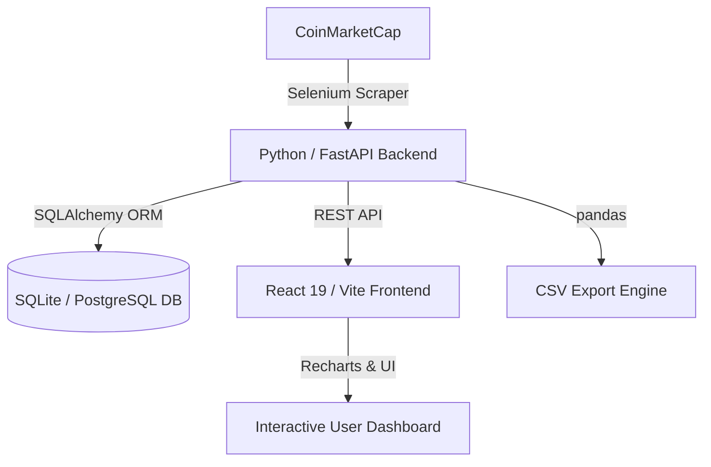

# CryptoTrack – Real-Time Cryptocurrency Price Tracker

A modern, production-ready, full-stack cryptocurrency monitoring and analytics dashboard powered by a Selenium-automated Python backend and a React/Vite frontend.

---

## 🌟 Features

- **Live Market Tracking:** Real-time prices, 24h percentage changes, market capitalization, and rankings for top cryptocurrencies.
- **Automated Web Scraping:** Selenium headless browser scraper targeting CoinMarketCap with retry logic, multi-strategy parsing, and graceful fallbacks.
- **Historical Price Logging:** Relational database storage (SQLite / PostgreSQL) tracking all historical price observations across scrape runs.
- **Interactive Analytics:**
  - Historical Price Line Chart with time-range filtering (1H, 24H, 7D, 30D, All)
  - Top 10 Market Capitalization comparison bar chart
  - 24h Gain/Loss performance comparison chart
  - Market dominance percentage indicators
- **Advanced Filtering & Sorting:** Multi-column sorting, live search filtering, gainer/loser filters, and pagination.
- **CSV Data Export:** One-click CSV export of historical records for all coins or filtered by specific currency.
- **Auto-Refresh Modes:** Configurable client-side auto-refresh intervals (5 min, 15 min, 30 min) plus manual on-demand scrape triggers.
- **Premium Dark Mode UI:** Modern glassmorphism aesthetic, Lucide icons, responsive layout with collapsible sidebar and mobile drawer.

---

## 🏗️ Architecture



---

## 📦 Tech Stack

### Frontend
- **React 19** with **Vite**
- **React Router v7** for single-page routing
- **Recharts** for interactive responsive charts
- **Lucide React** for icons
- **Axios** for API communication
- **Vanilla CSS** with custom design token system (dark-mode first, glassmorphism)

### Backend
- **Python 3.10+**
- **FastAPI** for high-performance async REST API
- **SQLAlchemy 2.0** ORM
- **Selenium 4** & **webdriver-manager** for automated headless Chrome data scraping
- **pandas** for data formatting & CSV exports
- **Uvicorn** ASGI web server
- **Pydantic v2** for data validation & serialization

---

## 🚀 Quick Start Guide

### Prerequisites
- Python 3.10+
- Node.js 18+ and npm
- Google Chrome browser installed (for Selenium scraping)

### 1. Backend Setup

```bash
# Navigate to backend folder
cd backend

# Create virtual environment
python -m venv .venv

# Activate virtual environment
# Windows (PowerShell):
.\.venv\Scripts\Activate.ps1
# Linux / macOS:
source .venv/bin/activate

# Install dependencies
pip install -r requirements.txt

# Start backend server
uvicorn app.main:app --reload --host 127.0.0.1 --port 8000
```

Backend will be accessible at:
- **API Base:** `http://127.0.0.1:8000`
- **Interactive Swagger Docs:** `http://127.0.0.1:8000/docs`
- **ReDoc:** `http://127.0.0.1:8000/redoc`

### 2. Frontend Setup

```bash
# In a new terminal, navigate to frontend folder
cd frontend

# Install npm packages
npm install

# Start development server
npm run dev
```

Frontend will be running at: `http://localhost:5173`

---

## 📡 API Endpoints Reference

| Method | Endpoint | Description |
|---|---|---|
| `GET` | `/api/health` | Service health check |
| `GET` | `/api/coins` | All tracked coins with latest price |
| `GET` | `/api/coins/top10` | Top 10 coins by rank |
| `GET` | `/api/coins/{symbol}` | Single coin detail with latest data |
| `GET` | `/api/coins/{symbol}/history` | Paginated price history for coin |
| `GET` | `/api/stats` | Market summary stats (gainers, losers, total cap) |
| `POST` | `/api/scrape` | Trigger Selenium scrape to fetch fresh market data |
| `GET` | `/api/scrape/status` | Most recent scrape execution status |
| `GET` | `/api/export/csv` | Download CSV of historical price records |

---

## 🛡️ License

MIT License. Built with love for real-time crypto intelligence.
